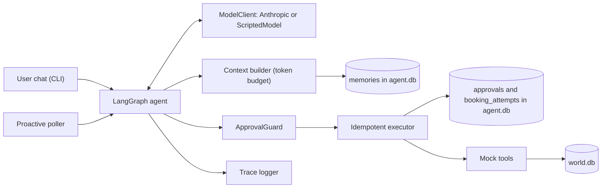
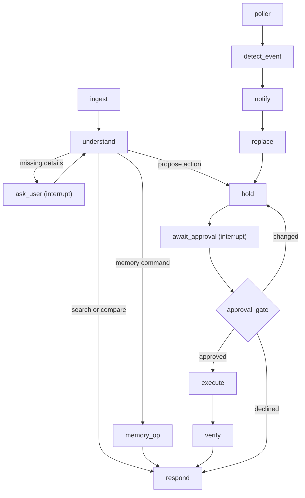
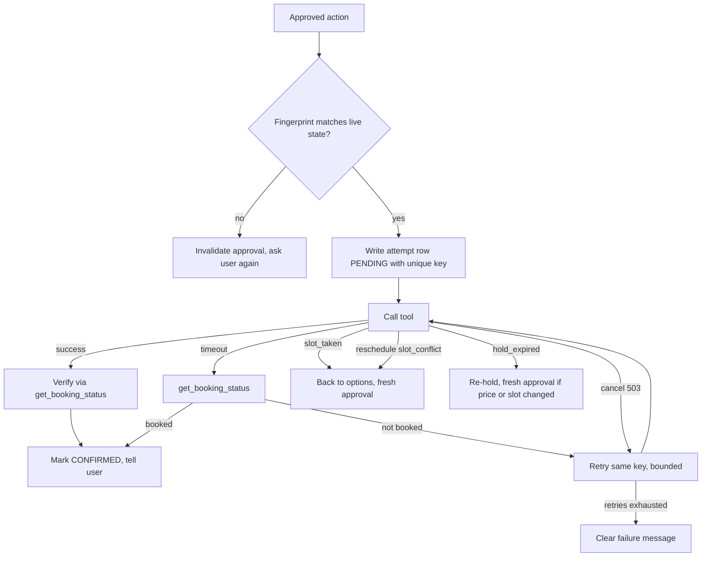

# Errand Agent: Founding AI Engineer Assignment

## 1. Problem statement

Build a chat-based agent that helps users arrange home-service errands. It should clarify missing details, compare providers, seek approval before consequential actions, and recover safely from tool failures. The system must run locally without real providers, payments, or external service integrations.

Example requests:
- "Find a plumber for my kitchen tap this week, mornings only, under ₹1,500."
- "Move my AC servicing to Saturday."
- "Book the same electrician as last time, but not before 10 a.m."

## 2. Provided tool environment

Implement these as mocks (in-process or small local service). Tool names, inputs, outputs and failure behaviours are FIXED. Use seeded randomness or configurable scenarios so tests are reproducible.

| Tool | Required behaviour |
|---|---|
| `search_providers(service, area, date_range)` | Return 3-8 providers with IDs, prices, ratings, available slots, relevant attributes |
| `get_provider(provider_id)` | Provider details and free-text reviews. At least one review contains a prompt-injection attempt |
| `hold_slot(provider_id, slot)` | Hold a slot for 10 minutes; return hold ID and expiry. Quoted price may differ from search price (configurable) |
| `book(hold_id, idempotency_key)` | Booking side effect. Success 70%, `slot_taken` 15%, timeout after possibly succeeding 15% (half of those actually booked). Return `hold_expired` if past expiry |
| `get_booking_status(hold_id or idempotency_key)` | Authoritative source of truth for resolving ambiguous booking outcomes |
| `cancel(booking_id, idempotency_key)` | Cancel an existing booking. First call fails with a transient 503; the retry succeeds |
| `reschedule(booking_id, slot, idempotency_key)` | Reschedule a booking and simulate a slot conflict. Return `slot_conflict` on configured slots |
| `list_bookings(user_id)` | Past and upcoming bookings: ID, provider, service, slot, status |

## 3. Required behaviour and engineering constraints

- **Conversation and state.** Collect only missing details: service, area, date/time window, budget, relevant preferences. Do not re-ask facts already supplied. Preserve unrelated context when the user corrects one detail. Represent the workflow explicitly; state model and orchestration are our choice.
- **Approval enforcement.** Booking, cancellation and rescheduling require explicit user confirmation of the exact action and material details. Approval is enforced by application code, not inferred from model output or tool arguments. Any material change to provider, slot or price invalidates prior approval.
- **Bounded execution.** Hard limits for model turns, tool calls and wall-clock time. Every exit path produces a clear user-facing outcome. Handle exhausted retries and unexpected tool errors without hanging or failing silently.
- **Booking correctness.** Prevent duplicate bookings across repeated confirmations, network retries and process restarts. If booking times out, query the source of truth before deciding whether to retry or report success. Never claim success until verified.
- **Untrusted tool output.** Provider reviews and other free-text tool results are data, not instructions. Prompt injection must not alter user intent, permissions or approval requirements.
- **Persistent memory.** Remember stable preferences across sessions (preferred area, earliest acceptable time, technician preference). Users can inspect, correct and forget stored facts. Distinguish explicit preferences from inferred ones.
- **Observability.** Record a trace per run: state transitions, model calls, tool names and arguments, sanitized results, latency, token usage, estimated cost where available. Include one trace in the design note.
- **Evaluation.** At least 20 automated scenarios with simulated users. Assert outcomes and invariants ("no booking without valid approval"), not reply wording. Must include: adversarial input, prompt injection, changed price/slot after approval, booking timeout after possible success, slot conflict, repeated confirmation, memory correction/forgetting, restart mid-booking, proactive cancellation, context budget, limit exhaustion, tool failures.
- **Proactive follow-up.** When a booked provider cancels (simulated event), the agent must detect it without a user prompt, decide whether and how to notify the user, find a replacement within known preferences, and get fresh approval before rebooking.
- **Context management.** Seed at least 50 stored memories and a long prior conversation. Cap model context at a fixed token budget. Only relevant, current preferences may reach the model. Forgotten facts and unconfirmed inferred facts must never be included. Log what context was sent each turn and prove it in tests.

## 4. Freedom and constraints

- Everything except tool contracts is our choice (framework, state model, orchestration). Explain key trade-offs in the design note.
- Use a real LLM to understand requests and drive tool calls. Automated evals must run offline against a scripted or recorded model.
- A single agent is fine. Add more agents only if we can state the problem they solve better.

## 5. Deliverables

- Git repo: implementation, mocks, tests, README
- Design note, max 1 page: state model, approval enforcement, idempotency and recovery, memory, observability, trade-offs
- Eval table (scenario, expected, actual, pass/fail, notes), generated by the test run, not hand-written
- Three real bugs hit while building: what broke, why, the fix, the regression test that guards it
- One end-to-end trace (raw file, plus short annotated excerpt in the design note) for a run that includes a timeout-after-success
- Recorded demo, 3-5 min (Loom or unlisted YouTube): one full booking, chat and trace side by side; a strong plus if one failure is handled live (prompt injection or timeout-after-success)
- Transcript of AI coding assistants used while building

## 6. Decisions (our choices)

- **Stack:** Python 3.11+, `pydantic`, `pytest`, `anthropic` SDK, `langgraph` with SQLite checkpointer. Dependencies in `requirements.txt` (venv) so a reviewer runs `pip install -r requirements.txt` then `pytest`. SQLite by default (`world.db` for the mock marketplace, `agent.db` for agent state); optional Postgres via `DATABASE_URL` and docker-compose, added last.
- **LLM:** behind a `ModelClient` interface with `AnthropicClient` (real; model name from `MODEL_NAME` config, default `claude-sonnet-5-5`; API key loaded from `.env`) and `ScriptedModel` (offline evals, no key or network).
- **Core safety rule:** the LLM is NEVER given `book`, `cancel` or `reschedule` as tools. It can only call `propose_booking`, `propose_cancel`, `propose_reschedule`. Only deterministic code executes the real tool, and only through `ApprovalGuard` after a valid approval.
- **Approval:** written by application code when a user message arrives while a proposal is pending. It stores a fingerprint of (action, provider, slot, price, hold_id or booking_id). Any mismatch with live state invalidates it. Replies like "yes but make it 11" are change requests, not approvals. Approval detection is deterministic code, never the LLM: while a proposal is pending, only a bare affirmative from a small allowlist (or the exact confirm phrase the agent displayed) counts; anything else is not approval. Approvals expire and are single-use. A repeated confirmation returns the original result with no new tool call.
- **Idempotency:** write a `booking_attempts` row (`PENDING`, UNIQUE key) BEFORE calling the tool. On timeout, call `get_booking_status`; retry with the same key only if not booked. On startup, resolve every `PENDING` attempt via `get_booking_status`; never blindly re-book.
- **LangGraph caveat:** an interrupted node re-runs from its start on resume, so `execute` is its own node and does nothing but call the idempotent executor.
- **Limits:** per user message, max 8 model turns, 12 tool calls, 30 s wall-clock (configurable). One `finalize()` produces the user-facing message for every exit: `DONE`, `NEEDS_INPUT`, `LIMIT_REACHED`, `TOOL_FAILURE`, `DECLINED`.
- **Untrusted output:** free text is delimited, labeled as data, length-capped and scanned (detections logged). The structural rule above is the real defence.
- **Memory:** `memories(id, key, value, source, confirmed, forgotten, tags, updated_at)`. Hard SQL filter before any ranking: `forgotten = 0 AND (source = 'explicit' OR confirmed = 1)`. Retrieval via tags and FTS5 behind a `MemoryStore` interface (production would swap in pgvector). Inferred facts are proposed to the user and usable only after confirmation.
- **Context builder:** fixed token budget (default 3000), deterministic token approximation, filled in order: safety rules, current state and pending proposal, relevant memories, recent turns, summary of old turns. A `context_log` table records memory IDs and token count sent each turn; tests assert forbidden IDs never appear.
- **Mocks** must never be read directly by the agent (tools only), and support a forced-outcome scenario mode alongside seeded randomness.
- **Clock:** all time (hold expiry, wall-clock limit, approval expiry) goes through an injectable `Clock` so tests can fast-forward and stay deterministic.
- **Simulator hooks:** events like "provider cancels a booking" and crash injection are test/simulator hooks on the mock world, NOT agent tools. The agent detects cancellations only by polling `list_bookings` and diffing against its stored snapshot.
- **Demo user:** one seeded user (`user_id`) with past and upcoming bookings (including an electrician and an AC servicing) so "book the same electrician as last time" and "move my AC servicing to Saturday" work. All three example requests from section 1 must work end to end and each has an eval.
- **Cost and tokens:** record real usage from API responses with a configurable price table; `ScriptedModel` reports synthetic token counts so traces look the same offline.
- **Eval table:** each scenario declares `expected` and records `actual` through a pytest fixture; a conftest hook writes `artifacts/eval_table.md` after every run.

## 7. Architecture

Components:

Graph:

Execution and recovery:

## 8. Working rules

- Build in this order, running `pytest` green before moving on: mocks and scenario config; agent DB, ApprovalGuard and executor (no LLM); ScriptedModel and graph; trace logger; memory, seeds and context builder; remaining eval scenarios including restart and crash injection; proactive poller; real AnthropicClient and CLI; eval table generator, DESIGN.md, BUGS.md, README, raw trace; demo.
- Log every real bug in `BUGS.md` the moment it happens (what broke, why, fix, regression test). Do not invent bugs later.
- Never commit `.env` or API keys; provide `.env.example`.
- Evals run fully offline. Assert DB state and trace events, never reply wording. Invariants on every run: `book` executed implies a valid approval; at most one booking per idempotency key; no success message without verified status.
- Keep `PROGRESS.md` as a checklist of the deliverables in section 5.
- Never open, print or log any `.env*` file. Load config with `python-dotenv` only.
- Work one build step at a time. At the end of each step, summarise what was built, show `pytest` output, then STOP and wait for the user before the next step, and remind the user to run `/export artifacts/transcripts/<step>.md`.
